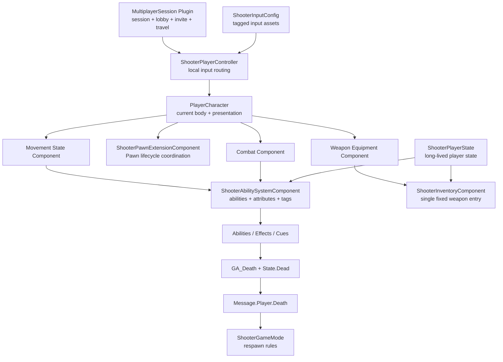

# ShooterGame Architecture

本文是当前架构的唯一事实来源。它描述已经存在的职责和运行时关系；没有从代码或运行结果确认的内容会明确标记为“待验证”。

## System Overview



## Ownership, Authority, Lifetime, Replication

| 状态或对象 | Owner / 所在位置 | Lifetime | Authority / 写入方 | Replication / 客户端职责 |
|---|---|---|---|---|
| ASC、AttributeSet | `AShooterPlayerState` | 玩家状态生命周期，跨当前 Pawn 重生存在 | Gameplay 权威修改由服务器执行 | ASC 按 GAS 规则复制；Pawn 重新绑定为 Avatar |
| 固定武器条目 | `UShooterInventoryComponent` on PlayerState | 组件跨 Pawn 存在；唯一条目在死亡时移除、新 Pawn 初始化时重新授予 | 服务器从 WeaponDataAsset 授予、删除并修改弹药；不支持槽位或拾取转移 | `InventoryEntries` OwnerOnly 复制，查询直接读取条目与其定义，不维护装备缓存 |
| 当前 Avatar | `APlayerCharacter` | 单个 Pawn 的 Spawn 到 EndPlay | 服务器 Possess；两端根据已知 PlayerState/Controller 初始化表现 | Pawn 与 Controller/PlayerState 复制回调触发幂等检查 |
| Pawn 生命周期编排 | `UShooterPawnExtensionComponent` on Character | 与当前 Pawn 相同 | 不拥有权威 Gameplay 数据，只协调当前端绑定与清理 | 组件本身不表达新的复制真相 |
| Equipped item id | `UShooterWeaponEquipmentComponent` on Character | 当前 Pawn | 服务器授予固定武器、死亡清理 | OwnerOnly 复制，用 ItemId 直接查询 Inventory；客户端临时解绑不抹掉复制字段 |
| Equipped weapon actor | 当前 Character 的 Equipment Component 创建 | 当前装备/当前 Pawn | 仅服务器 Spawn/Destroy | Actor 指针与表现用 WeaponDefinition 复制，客户端只刷新网格、附着和反馈；Actor 不保存弹药 |
| `State.Dead` | PlayerState-owned ASC | 由死亡 Effect 到重生重置 | ServerOnly Death Ability 应用 | 客户端监听 Tag，切换当前 Pawn 表现 |
| MatchState / 比赛结束时间 | `AShooterGameMode` 决策，`AShooterGameState` 保存公共复制状态 | 当前游戏地图中的一场比赛 | 服务器启动、结束比赛并设置结束时间 | GameState 复制阶段与结束时间，HUD 使用同步服务器时间计算剩余秒数 |
| Session / Lobby | `MultiplayerSession` GameInstance 子系统和 UI 边界 | GameInstance / 当前 UI 生命周期 | Host 创建 Session 并执行 ServerTravel | Join 成功后本地 PlayerController 执行 ClientTravel |

### Seamless Travel boundary

Session 插件的 `MultiplayerSessionFlowSubsystem.StartHostedGame()` 路径会在 Authority 端设置 `GameMode->bUseSeamlessTravel = true` 后执行 `ServerTravel`。这证明项目启用了 Seamless Travel 路径，但当前文档没有足够运行证据证明 ASC、Inventory、PawnExtension 和 UI 在完整旅行前后都保持正确；该场景仍标记为待验证。

## Runtime Flow 1: Pawn Initialization

```text
BeginPlay / OnRep_PlayerState / NotifyControllerChanged
  -> PawnExtension.CheckDefaultInitialization
  -> resolve ShooterPlayerState and its ASC
  -> detach stale Avatar when necessary
  -> PlayerState.InitializeAbilitySystem(CurrentPawn)
  -> ASC Owner = PlayerState, Avatar = CurrentPawn
  -> bind Health / Movement / State.Dead delegate
  -> apply dead or alive presentation from current Tag state
  -> refresh Equipment: authority grants fixed Hitscan weapon, clients refresh presentation
```

`PossessedBy` 由引擎的 Controller 变更路径最终进入 `NotifyControllerChanged`；客户端在 `OnRep_PlayerState` 后补齐依赖。所有入口调用同一套幂等检查，不各自复制初始化逻辑。详细清理顺序见 [Pawn 生命周期文档](../systems/pawn-lifecycle.md)。

## Runtime Flow 2: Fire, Damage, Death, Respawn

```text
local input
  -> ShooterPlayerController routes Input.* tag
  -> Combat.StartFireInput / ServerStartFire RPC
  -> ShooterAbilitySystemComponent activates GA_FireWeapon (ServerOnly)
  -> FireSingleShot reads Equipment's current Inventory entry + WeaponDataAsset
  -> Inventory consumes one magazine round on authority
  -> hitscan trace
  -> Damage GameplayEffect / AttributeSet
  -> GameplayEvent.Death
  -> GA_Death (ServerOnly)
  -> apply State.Dead + broadcast Message.Player.Death
  -> ShooterGameMode schedules respawn
  -> UnPossess + destroy old Pawn
  -> PlayerState.ResetCombatStateForRespawn
  -> RestartPlayer
  -> new Pawn binds to the same PlayerState-owned ASC
  -> authority grants/equips the default Hitscan weapon with default ammo data
```

- 自动开火由 `AbilityTask_WaitDelay` 驱动，不依赖 Actor Tick。
- `State.Dead` 是死亡事实；Character 的碰撞、移动、输入和 Montage 只是当前 Pawn 的表现。
- GameMode 负责重生规则，Ability 不直接调用 `RestartPlayer`。
- 当前死亡处理销毁装备 Actor 并删除对应 Inventory 条目，不生成掉落；新 Pawn 自动获得默认武器。拾取、切槽位、丢弃、掉落表现和 Projectile 的代码、输入与对应资源已移除。
- 默认武器配置在 Equipment 的 `DefaultWeaponDefinition`，原生默认值为现有 `DA_Weapon_AK47`。静态配置只从 Inventory 条目引用的 WeaponDataAsset 读取，弹匣与备弹只由 Inventory 保存和修改。Combat 负责换弹计时，完成后由 Inventory 将备弹转入弹匣。当前不实现开火或换弹预测。
- `AShooterWeaponEquipmentActor` 直接继承 `AActor`，仅负责网格、附着、枪口与表现配置复制。Equipment 在 deferred spawn 后先记录装备所有权，再执行 `FinishSpawning`；武器定义在构造脚本和 BeginPlay 前就绪。客户端在 Actor、定义和 Pawn readiness 到达后刷新表现，不依赖 Inventory 弹药复制回调。
- 已删除 WeaponInstance、Actor 弹药快照、`FWeaponPickupData`、旧 WeaponBase 和 AK47 原生子类及 fallback 配置。`BP_AK47_Equipment` 改为继承通用 Equipment Actor，`DA_Weapon_AK47.EquipmentActorClass` 仍引用原 Blueprint；资源名、模型、动画与挂点保持原有配置。

第一人称相机、自己的角色双臂、手部与枪械动画、瞄准过渡和后坐力由 `APlayerCharacter` 的原生组件与 C++ 驱动。`UShooterFirstPersonAnimInstance` 计算动画状态，`ABP_OwnFirstPerson` 只播放和混合姿势。双臂从自己的角色网格裁出，重新绑定到 Infima 模板骨架，直接使用原始动画；视角武器使用模板原枪及独立弹匣。世界装备外观已通过现有 `DA_Weapon_AK47.WeaponMesh` 换为模板枪与弹匣合并的静态版本，Blueprint 与配置资源保留旧名称。视角表现不拥有 Gameplay 数据，服务器伤害使用通用 Equipment Actor 与世界枪口挂点。资产和生命周期契约见 [第一人称系统](../systems/first-person.md)。完整联机回归仍待开发者验证。

第三人称左手通过世界枪的 `LeftHandGrip` Socket 保持握持：`UShooterAnimInstance` 用 C++ 计算右手骨骼空间的目标与启用权重，`ABP_Player` 在移动姿势混合之后用 FABRIK 调整左臂和手腕。该状态只服务于动画表现，不复制新的 Gameplay 数据；第一人称网格不启用此约束。挂点维护方法与验证范围见 [第一人称系统](../systems/first-person.md)。

## Runtime Flow 3: Session and Travel


```text
Host
  -> Menu submits HostGame to MultiplayerSessionFlowSubsystem
  -> MultiplayerSessionsSubsystem.CreateSession (one owned OSS operation)
  -> flow handles create completion and ServerTravel to Lobby?listen
  -> destination world + local controller ready
  -> UIManager shows the WBP lobby panel (host invite actions / client waiting state)
  -> host starts game
  -> flow enables seamless travel + ServerTravel to gameplay map

Client
  -> Steam accepted-invite event
  -> flow joins directly when disconnected; an active room requires explicit confirmation
  -> MultiplayerSessionsSubsystem.JoinSession + resolve connect address
  -> flow calls local PlayerController.ClientTravel(address)
  -> destination world + actual server-provided PlayerController ready

Leave / failure
  -> flow serializes session cleanup
  -> destroy the local named session + return to the local menu (closes gameplay connection)
  -> Idle, or CleanupFailed with explicit retry if cleanup did not complete
```

`MultiplayerSessionsSubsystem` 拥有 Create / Join / Destroy 与邀请回调；`LobbyInviteSubsystem` 拥有好友刷新和发送邀请；`MultiplayerSessionFlowSubsystem` 拥有本地业务阶段、Travel、退出和失败恢复；`MultiplayerSessionUIManagerSubsystem` 只管理现有 Widget 和输入模式。地图配置集中在 Project Settings 的 Multiplayer Session 设置中，项目值位于 `Config/DefaultGame.ini`。当前没有 Session 搜索入口。详细契约和待验证场景见 [联机流程文档](../systems/multiplayer-session.md)。

核心 ShooterGame Module 不负责在线服务回调；插件也不决定伤害、死亡或比赛 Gameplay 状态。联机菜单、大厅、好友行和邀请确认采用 WBP Designer 布局；C++ Widget 只订阅状态和调用服务。RootWidget 管理 UI layer，UIManager 管理本地输入与旅行时的 UI 清理。

## Runtime Flow 4: Match Skeleton

`AShooterGameMode` 继承 `AGameMode`，配套 `AShooterGameState : AGameState`。当前第一小步沿用引擎自动开局条件：进入 `InProgress` 后完成父类出生处理，再记录 `MatchEndServerTime = ServerTime + MatchDuration`（默认 180 秒）。引擎已有的 `AGameMode::Tick` 检查 `ReadyToEndMatch`，时间到后调用 `EndMatch`，进入 `WaitingPostMatch`；项目没有新增比赛 Tick 或逐秒递减状态。

`UShooterMatchWidget` 读取 GameState 快照和同步服务器时间，显示等待、倒计时与比赛结束。布局保存在 `/Game/ShooterGameContent/HUD/WBP_MatchStatus` 的 Designer，两个必需控件为 `MatchPhaseText` / `MatchTimeText`。阶段与结束时间可能分开复制，时间未到达时显示同步中。HUD 在血量配置可能提前退出之前独立创建比赛 Widget。

本小步只实现比赛阶段、计时和显示；等待所有原有玩家加载、关闭中途加入、比赛结束停止战斗与重生、3 秒重生和外围出生点仍待后续接入。`WaitingPostMatch` 不代表现有战斗逻辑已经停止。详见 [比赛生命周期](../systems/match-lifecycle.md)。

第二步的 `AShooterControlPoint` 已接入 Capsule 候选跟踪与生命周期事件；GameMode 持有当前计时玩家、时间起点和单个计分 Timer，PlayerState 复用原生 Score 并持有服务器侧余数，GameState 复制据点状态。HUD 增加据点与个人积分读取。占用判断、整秒兑换和计时玩家切换由开发者补齐，并确认计分测试通过。检测体积使用独立的 ControlPoint Object Channel（`ECC_GameTraceChannel1`），避免被查询 WorldStatic/WorldDynamic/Pawn 的武器射线命中；碰撞隔离修复后的多人运行仍待复测。接口契约、调用顺序与 Editor 配置见 [据点计分框架](../systems/control-point-scoring.md)。

第三步增加 GameState-owned 的 `FShooterMatchResults` 值快照、动作截止检查、GameMode-owned 重生 Timer 和结算 WBP 数据接口。MatchWidget 继续读取快照；ResultsWidget 管理结果行展示，HUD 管理本地输入与准星/血量显示。三个开发者入口尚待补齐，不能把现有 WaitingPostMatch 或框架构建通过理解为结算与结束清理已完整运行。职责和资产契约见 [结算与 UI 框架](../systems/match-results.md)。

## System Boundaries

| 领域 | 负责 | 不负责 |
|---|---|---|
| Gameplay Framework | Controller、PlayerState、Pawn、GameMode 生命周期 | 在线服务实现、UI 布局 |
| GAS | Ability、Effect、Attribute、Tag、Cue | Session、Lobby、地图旅行规则 |
| Inventory / Equipment | 唯一固定武器条目、当前装备关系、武器 Actor 表现 | 拾取、切槽位、丢弃、比赛胜负、重生时机 |
| MultiplayerSession Plugin | Session、Lobby、Invite、Travel 和对应 UI 协调 | 武器、伤害和 ASC 状态 |
| UI | 读取状态、收集本地输入、显示反馈 | 直接写入服务器权威 Gameplay 状态 |

## Code Entry Points

| 关注点 | 入口 |
|---|---|
| PlayerState-owned ASC / Inventory | `Source/ShooterGame/Public/PlayerState/ShooterPlayerState.h` |
| Pawn 与组件聚合 | `Source/ShooterGame/Public/Character/PlayerCharacter.h` |
| Pawn 初始化和解绑 | `Source/ShooterGame/Public/Components/ShooterPawnExtensionComponent.h` |
| 输入 Tag 到 Ability | `Source/ShooterGame/Public/AbilitySystem/ShooterAbilitySystemComponent.h` |
| 逻辑库存 | `Source/ShooterGame/Public/Components/ShooterInventoryComponent.h` |
| 当前装备与武器 Actor | `Source/ShooterGame/Public/Components/ShooterWeaponEquipmentComponent.h` |
| 开火路径 | `Source/ShooterGame/Public/AbilitySystem/Abilities/GA_FireWeapon.h` |
| 死亡到重生消息边界 | `Source/ShooterGame/Public/Messages/ShooterGameplayMessageSubsystem.h` |
| 重生规则 | `Source/ShooterGame/Public/GameMode/ShooterGameMode.h` |
| 比赛公共状态与服务器时钟 | `Source/ShooterGame/Public/GameState/ShooterGameState.h` |
| 比赛状态与倒计时显示 | `Source/ShooterGame/Public/HUD/ShooterMatchWidget.h` |
| Session / Join / Invite | `Plugins/MultiplayerSession/Source/MultiplayerSession/Public/MultiplayerSessionsSubsystem.h` |
| Host / Leave / Invite confirmation / Travel | `Plugins/MultiplayerSession/Source/MultiplayerSession/Public/MultiplayerSessionFlowSubsystem.h` |
| Multiplayer map configuration | `Plugins/MultiplayerSession/Source/MultiplayerSession/Public/MultiplayerSessionSettings.h` |

## Current Invariants and Known Limits

- 项目完成初始化后，ASC Owner 必须是 `AShooterPlayerState`，Avatar 必须是当前有效的 `APlayerCharacter`；解绑允许 Avatar 为空。引擎默认初始化会先临时使用 Owner 作为 Avatar。
- 旧 Pawn 只有在仍是 ASC Avatar 时才能清除 Avatar，不能误清新 Pawn 的绑定。
- 客户端不能 Spawn/Destroy 权威 Equipment Actor 或修改 Inventory 真相。
- PawnExtension 解绑必须允许从 UnPossess、Controller cleared 和 EndPlay 重复进入。
- 当前解绑将激活 Ability 统一视为 Pawn-scoped 并取消；未来若存在需要跨 Avatar 保留的 Ability，必须先明确新的保留契约。
- Inventory 当前使用 OwnerOnly `TArray` 复制，最多一个固定武器条目；不保留多槽位逻辑。
- 2026-10-05，精简后的主机与客户端双人 Gameplay 回归由开发者确认通过，覆盖持枪、双向伤害/击杀、连续重生恢复和无掉落/重复武器表现；验证范围与证据见 [Pawn 生命周期文档](../systems/pawn-lifecycle.md)。
- 本次测试入口与设备拓扑未说明；Steam 好友跨设备、三人及以上观察、弱网、完整 Seamless Travel 和 Dedicated Server 仍待分别验证，不从静态代码或双人 Gameplay 结果推断通过。
